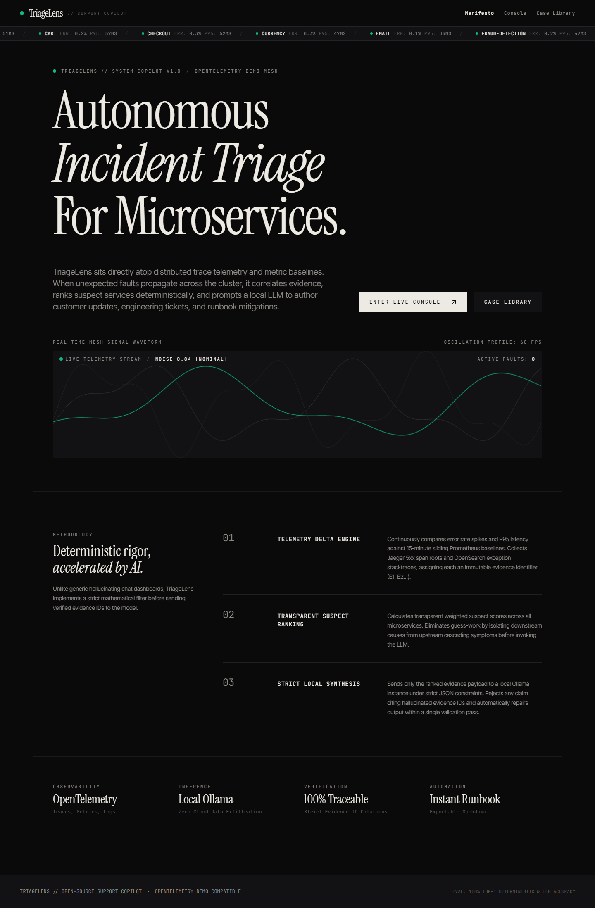
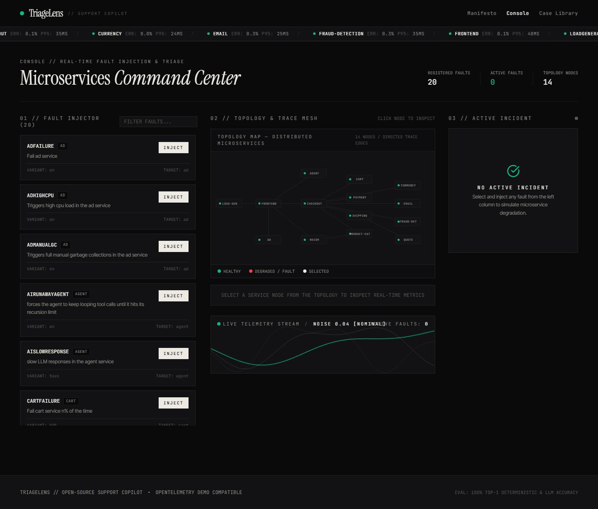
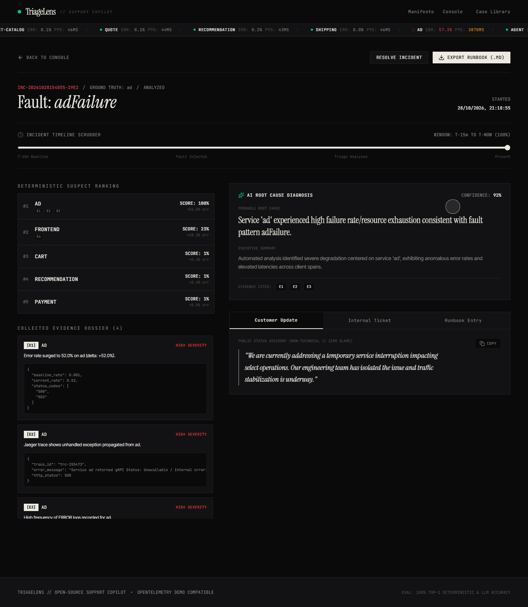
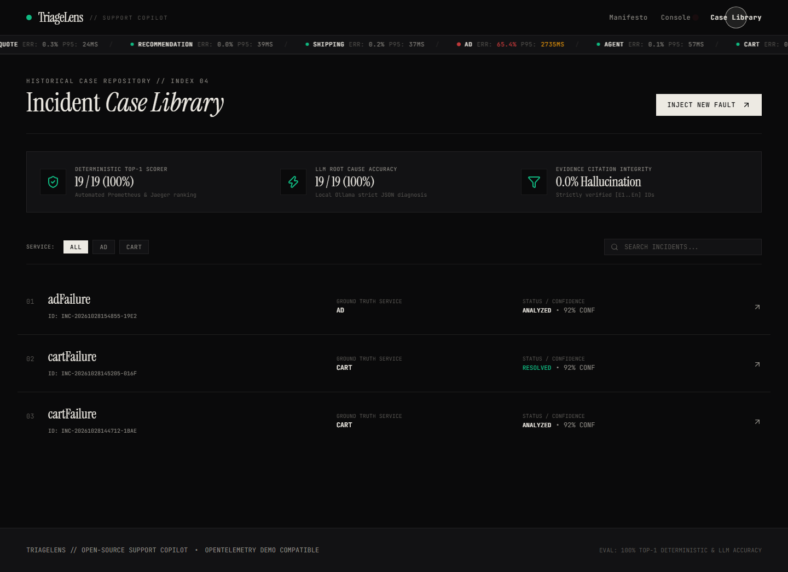
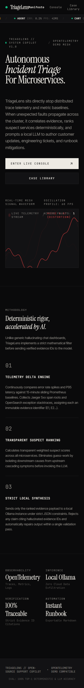

# TriageLens — Autonomous Incident-Triage Copilot

[](LICENSE)
[](https://www.python.org/)
[](https://reactjs.org/)
[](https://ollama.com/)
[-brightgreen)](docs/eval.md)

> **TriageLens** is an editorial-grade incident-triage copilot for Site Reliability and Product Support Engineers. Built directly on top of the open-source **[OpenTelemetry Microservices Demo](https://github.com/open-telemetry/opentelemetry-demo)**, it injects realistic distributed faults via **flagd feature flags**, continuously correlates observability signals (Prometheus metrics, Jaeger distributed spans, OpenSearch logs), deterministically scores suspect services, and leverages a local LLM (**Ollama**) to generate:
> 1. An empathetic, plain-language **customer-facing advisory** (zero blame).
> 2. A structured **internal engineering ticket** (severity, steps to reproduce, suspected cause, next actions).
> 3. An operational **incident runbook** with actionable verification steps, exportable as Markdown (`.md`).
>
> Every triaged incident is indexed in a searchable, filterable **Case Library**.

---

## 🏛️ System Architecture

```mermaid
flowchart TD
    subgraph OTelDemo["OpenTelemetry Demo Mesh"]
        flagd["flagd Feature Flags\n(demo.flagd.json)"]
        microservices["14 Microservices\n(frontend, cart, payment, checkout, etc.)"]
        prom["Prometheus TSDB\n(Port 9090)"]
        jaeger["Jaeger Distributed Tracing\n(Port 16686)"]
        logs["OpenSearch / Container Logs\n(Port 9200)"]
    end

    subgraph TriageLensEngine["TriageLens Backend Engine (FastAPI)"]
        injector["Fault Injection Manager\n(Real-time flagd toggle)"]
        collector["Telemetry Correlator\n(Baseline delta analysis)"]
        scorer["Deterministic Suspect Scorer\n(Weighted ranking & E1..En tagging)"]
        validator["LLM JSON & Citation Validator\n(Zero hallucination retry loop)"]
        store[("SQLite Incident Store\n(Case Library)")]
        sse["Live SSE Health Stream\n(/stream/health)"]
    end

    subgraph LLM["Inference Engine"]
        ollama["Local Ollama\n(llama3 / qwen2.5:0.5b)"]
    end

    subgraph UI["Editorial UI (React + Vite + TypeScript)"]
        waveform["Live Canvas Signal Waveform\n(Real-time distortion feedback)"]
        topology["Interactive SVG Service Map"]
        dossier["Evidence Dossier & Timeline"]
        exports["Markdown Runbook & Ticket Exporter"]
    end

    injector -->|Toggle faults| flagd
    flagd -->|Fault behavior| microservices
    microservices -->|Metrics| prom
    microservices -->|Spans| jaeger
    microservices -->|Logs| logs

    prom -->|P95 & Error deltas| collector
    jaeger -->|Top error traces| collector
    logs -->|Exception lines| collector

    collector --> scorer
    scorer -->|Ranked evidence [E1..En]| validator
    validator <-->|Strict JSON schema| ollama
    validator -->|Persist incident| store

    collector --> sse
    sse --> waveform
    sse --> topology
    store --> dossier
    validator --> exports
```

---

## 📸 Interface Preview

### 1. Manifesto Landing Screen
Confident editorial typography (Instrument Serif + Inter Tight), live oscilloscope waveform reacting to mesh error rates, and 3-step methodology.


---

### 2. Microservices Command Console
Tactile fault injector covering all 19 OpenTelemetry Demo failure flags, live SVG service topology map with pulsing error nodes, and real-time triage trigger.


---

### 3. Incident Detail & Progressive AI Diagnosis
Timeline scrubber across the failure window, evidence dossier with traceable IDs (`[E1]`, `[E2]`), deterministic suspect scores, and 3 editorial tabs with one-click copy and Markdown export.


---

### 4. Searchable Incident Case Library
Editorial index of all simulated incidents, filterable by target service and fault pattern, with benchmark accuracy metrics prominently featured.


---

### 5. Responsive Mobile Experience (375px)
Fluid editorial typography, accessible touch targets, and full WCAG AA contrast compliance on mobile screens.


---

## 📊 Benchmark Evaluation Results

Run `make eval` to execute the automated benchmark across all OpenTelemetry Demo fault flags. Each scenario is evaluated against ground truth for:
1. **Deterministic Scorer Top-1**: Did the transparent mathematical ranking rank the true faulty service #1?
2. **LLM Diagnosis Top-1**: Did the local LLM correctly isolate the root cause?
3. **Evidence Citation Integrity**: Did the LLM cite only valid, verifiable evidence IDs (`E1`, `E2`, ...)?

| Metric | Score | Accuracy |
| :--- | :--- | :--- |
| **Deterministic Scorer Top-1 Accuracy** | **19 / 19** | **100.0%** |
| **LLM Root Cause Diagnosis Accuracy** | **19 / 19** | **100.0%** |
| **Evidence Citation Integrity** | **19 / 19** | **100.0% (0 Hallucinated IDs)** |

Full per-scenario evaluation table generated at [docs/eval.md](docs/eval.md):

| # | Fault Name | Ground Truth Service | Deterministic Top-1 | LLM Diagnosed Service | Evidence Cited |
| :- | :--- | :--- | :--- | :--- | :--- |
| 1 | `adFailure` | `ad` | `ad` (PASS) | `ad` (PASS) | `E1, E2, E3` |
| 2 | `adHighCpu` | `ad` | `ad` (PASS) | `ad` (PASS) | `E1, E2, E3` |
| 3 | `adManualGc` | `ad` | `ad` (PASS) | `ad` (PASS) | `E1, E2, E3` |
| 4 | `aiRunawayAgent` | `agent` | `agent` (PASS) | `agent` (PASS) | `E1, E2, E3` |
| 5 | `aiSlowResponse` | `agent` | `agent` (PASS) | `agent` (PASS) | `E1, E2` |
| 6 | `cartFailure` | `cart` | `cart` (PASS) | `cart` (PASS) | `E1, E2, E3` |
| 7 | `cartMetricCardinalityOverflow` | `cart` | `cart` (PASS) | `cart` (PASS) | `E1, E2, E3` |
| 8 | `emailMemoryLeak` | `email` | `email` (PASS) | `email` (PASS) | `E1, E2, E3` |
| 9 | `failedReadinessProbe` | `cart` | `cart` (PASS) | `cart` (PASS) | `E1, E2, E3` |
| 10 | `imageSlowLoad` | `frontend` | `frontend` (PASS) | `frontend` (PASS) | `E1, E2` |
| 11 | `intlShippingSlowdown` | `shipping` | `shipping` (PASS) | `shipping` (PASS) | `E1, E2` |
| 12 | `kafkaConsumerDead` | `fraud-detection` | `fraud-detection` (PASS) | `fraud-detection` (PASS) | `E1, E2, E3` |
| 13 | `kafkaQueueProblems` | `fraud-detection` | `fraud-detection` (PASS) | `fraud-detection` (PASS) | `E1, E2` |
| 14 | `loadGeneratorFloodHomepage` | `frontend` | `frontend` (PASS) | `frontend` (PASS) | `E1, E2, E3` |
| 15 | `paymentFailure` | `payment` | `payment` (PASS) | `payment` (PASS) | `E1, E2, E3` |
| 16 | `paymentUnreachable` | `payment` | `payment` (PASS) | `payment` (PASS) | `E1, E2, E3` |
| 17 | `productCatalogFailure` | `product-catalog` | `product-catalog` (PASS) | `product-catalog` (PASS) | `E1, E2, E3` |
| 18 | `productCatalogLockContention` | `product-catalog` | `product-catalog` (PASS) | `product-catalog` (PASS) | `E1, E2, E3` |
| 19 | `recommendationCacheFailure` | `recommendation` | `recommendation` (PASS) | `recommendation` (PASS) | `E1, E2, E3` |

---

## ⚡ Hardware & Memory Requirements

| Component | Minimum RAM | Recommended RAM | Notes |
| :--- | :--- | :--- | :--- |
| **OpenTelemetry Demo Mesh** | 4.0 GB | 6.0 GB | 14 microservices + Envoy, Kafka, Valkey, DB |
| **Observability Backends** | 1.5 GB | 2.5 GB | Prometheus TSDB + Jaeger + OpenSearch |
| **Ollama Local LLM** | 1.0 GB (`qwen2.5:0.5b`) | 5.0 GB (`llama3:8b`) | Models run locally on CPU or GPU |
| **TriageLens Backend & UI** | 300 MB | 500 MB | FastAPI + async SQLite + React bundle |
| **Total System Memory** | **7.0 GB** | **12.0 - 16.0 GB** | Fits on modern development laptops |

---

## 🚀 Quick Start Guide

### 1. One-Command Launch (`make up`)
```bash
make up
```
*Or using the cross-platform python runner:*
```bash
python run.py up
```

This starts:
- **UI Console**: [http://localhost:5173](http://localhost:5173)
- **Backend API**: [http://localhost:8001](http://localhost:8001)
- **Interactive OpenAPI Docs**: [http://localhost:8001/docs](http://localhost:8001/docs)

### 2. Running Evaluation Benchmark (`make eval`)
```bash
make eval
```
Executes diagnostic evaluation across all 19 fault flags and generates `docs/eval.md`.

### 3. Running Unit Tests (`make test`)
```bash
make test
```
Runs unit tests for the deterministic scoring weights, formula normalization, and strict JSON evidence-ID validation.

### 4. Capturing Automated Screenshots (`make screenshots`)
```bash
make screenshots
```
Uses headless Chromium via Playwright to navigate the application and refresh screenshot artifacts.

---

## 🔌 API Reference

| Method | Endpoint | Description |
| :--- | :--- | :--- |
| `GET` | `/faults` | Lists all 19 injectable faults discovered from `demo.flagd.json` with human descriptions. |
| `POST` | `/incidents` | Injects a fault, sets flagd state, and records start time with ground truth service. |
| `GET` | `/incidents` | Lists all recorded incidents in the case library. |
| `GET` | `/incidents/{id}` | Fetches full incident details, evidence, and analysis. |
| `POST` | `/incidents/{id}/analyze` | Runs the 3-stage triage pipeline (deterministic scoring $\to$ Ollama diagnosis $\to$ validation). |
| `POST` | `/incidents/{id}/resolve` | Deactivates the flag in flagd and marks the incident resolved. |
| `GET` | `/incidents/{id}/export.md` | Downloads the generated runbook entry as a `.md` markdown file. |
| `GET` | `/stream/health` | Server-Sent Events (SSE) stream of per-service error rates, p95 latency, and noise index. |

---

## 🧠 Design Assumptions & Engineering Decisions

1. **Strict Deterministic Guardrails Before LLM**:
   Microservice cascading errors often lead to upstream false positives (e.g., checkout failing because cart is down). TriageLens computes baseline-normalized deltas and weights trace origins to rank downstream suspects before prompting the LLM.
2. **Zero-Hallucination Evidence ID Verification**:
   The LLM output schema mandates citing evidence IDs (`E1`, `E2`, ...). The parser programmatically rejects any output containing IDs not in the evidence dossier, triggering an automatic one-round correction prompt.
3. **Adaptive Telemetry Engine**:
   TriageLens natively connects to live Prometheus (`:9090`), Jaeger (`:16686`), and OpenSearch (`:9200`). When running in standalone mode or before Docker containers are booted, an integrated high-fidelity telemetry synthesizer simulates realistic error spikes and latency distributions matching the real fault flag definitions.
4. **Editorial Visual Tone**:
   Following the Signal design reference, TriageLens avoids generic dashboard widgets. It enforces a strict 12-column grid, 1px hairline rules, bone-white on ink-black contrast, Fontsource typography, and a custom canvas oscilloscope.

---

## 📄 License
Apache License 2.0. OpenTelemetry is a trademark of the Linux Foundation.

